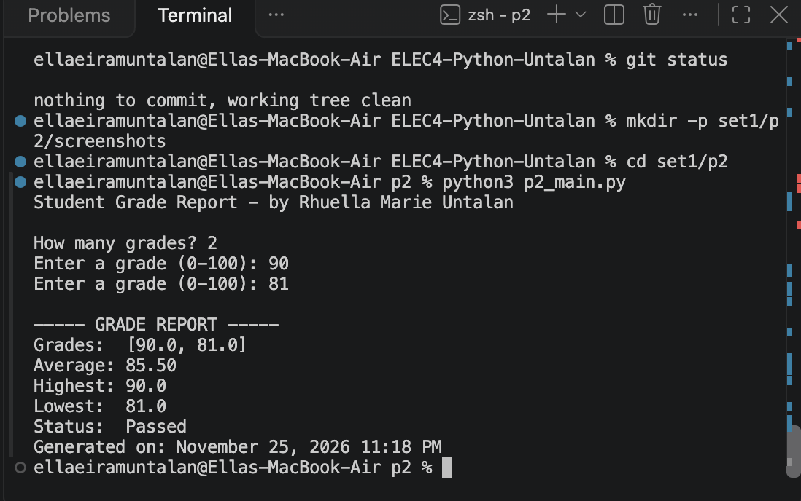
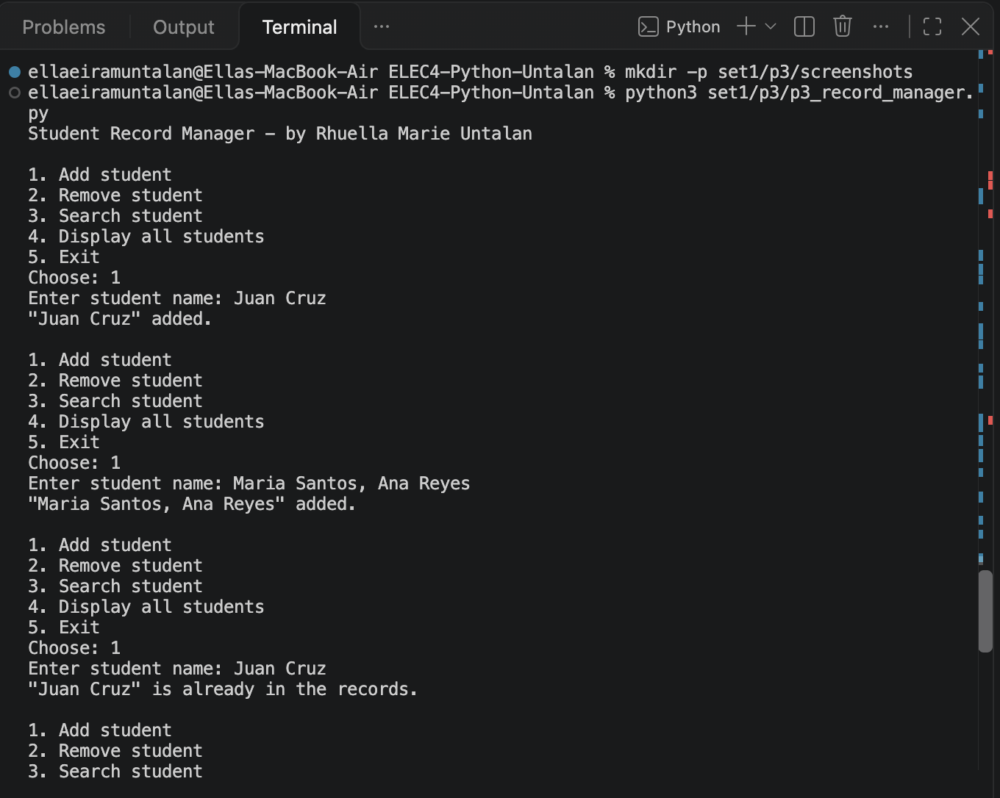

# ELEC 4 – Python Programming

**Name:** UNTALAN, RHUELLA MARIE C.
**Section:** IV-BSIT A
**Course:** ELEC 4 – Python Programming
**Instructor:** Carl Gustaf Patrik B. Ferrer
**Reference:** [Python Full Course for free – Bro Code](https://www.youtube.com/watch?v=ix9cRaBkVe0)

This repository contains my outputs for the ELEC 4 Self-Paced Learning Assignment (lessons from November 9–20, 2026).

---

## Activities

### Set 1 (Nov 23–29, 2026)

| Code | Activity | Description | Folder |
|------|----------|-------------|--------|
| P1 | Student Grade Calculator | Menu-driven program that uses user-defined functions to compute the average, highest, lowest, and pass/fail status of grades. | [set1/p1](set1/p1/) |
| P2 | Custom Module: student_utils | A reusable `student_utils` module imported by a main program, plus a built-in module for the report date and time. | [set1/p2](set1/p2/) |
| P3 | Student Record Manager | Adds, removes, searches (partial match), and displays student names using lists and sets, with duplicate prevention. | [set1/p3](set1/p3/) |
| P4 | Safe Menu Program | Menu program that handles bad input with `try`, `except`, `else`, and `finally` so it never crashes. | [set1/p4](set1/p4/) |

### Set 2 (Nov 30–Dec 6, 2026)

_To be added after Set 2 is complete._

---

## Requirements

- Python 3.x
- No external packages needed (only built-in modules are used)

Clone the repository and go into it:

```bash
git clone https://github.com/Ella-Eirams/ELEC4-Python-Untalan.git
cd ELEC4-Python-Surname
```

---

## How to Run

### P1 – Student Grade Calculator

```bash
python set1/p1/p1_grade_calculator.py
```

Choose **Enter grades**, type the grades (0–100), then choose **View results** to see the average, highest, lowest, and pass/fail status. A passing average is 75.


### P2 – Custom Module: student_utils

Run this from inside the `p2` folder so Python can find `student_utils.py`:

```bash
cd set1/p2
python p2_main.py
```



### P3 – Student Record Manager

```bash
python set1/p3/p3_record_manager.py
```

Menu options: add, remove, search, and display all students. Names are treated as case-insensitive (`Juan Cruz` and `juan cruz` count as the same name), and searching works on part of a name.




### P4 – Safe Menu Program

```bash
python set1/p4/p4_exceptions.py
```

Handled errors: non-numeric input (`ValueError`), division by zero (`ZeroDivisionError`), a missing file (`FileNotFoundError`), and an invalid menu choice.


---

## Repository Structure

```
ELEC4-Python-Surname/
├── README.md
├── .gitignore
├── set1/
│   ├── p1/
│   │   ├── p1_grade_calculator.py
│   │   └── screenshots/
│   ├── p2/
│   │   ├── student_utils.py
│   │   ├── p2_main.py
│   │   └── screenshots/
│   ├── p3/
│   │   ├── p3_record_manager.py
│   │   └── screenshots/
│   └── p4/
│       ├── p4_exceptions.py
│       └── screenshots/
└── set2/
```
