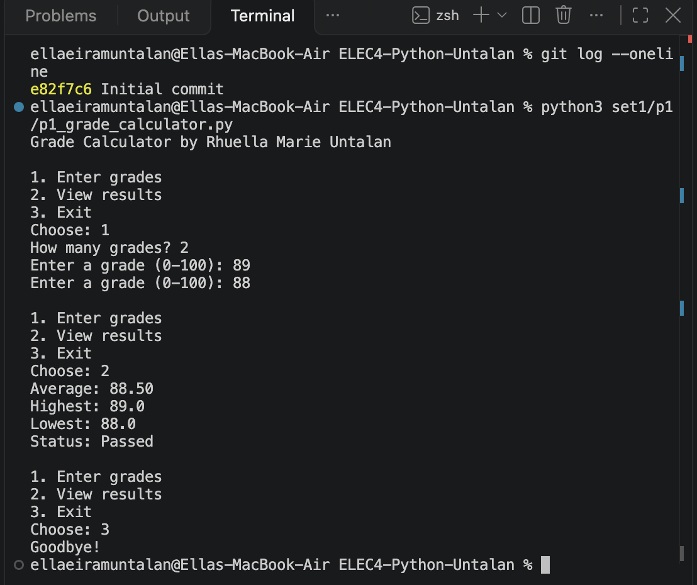
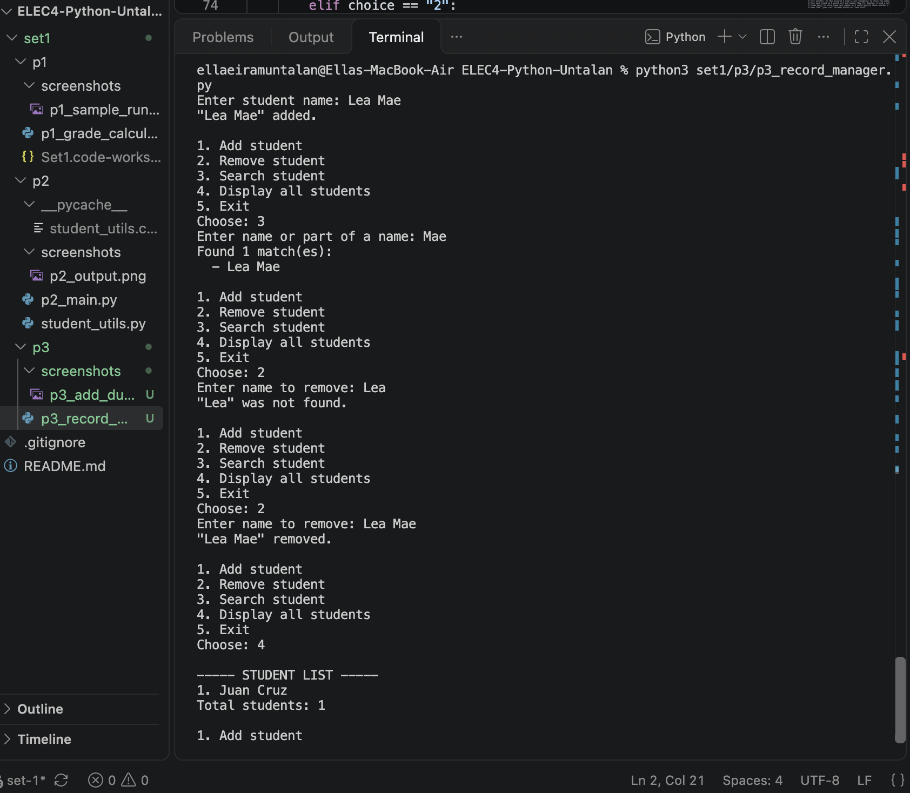
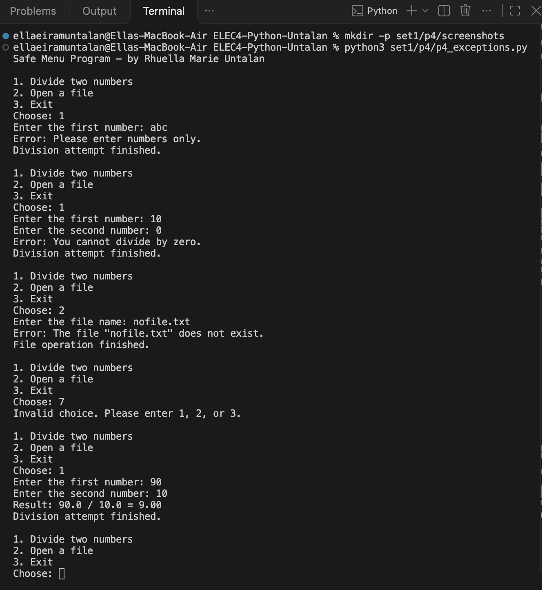
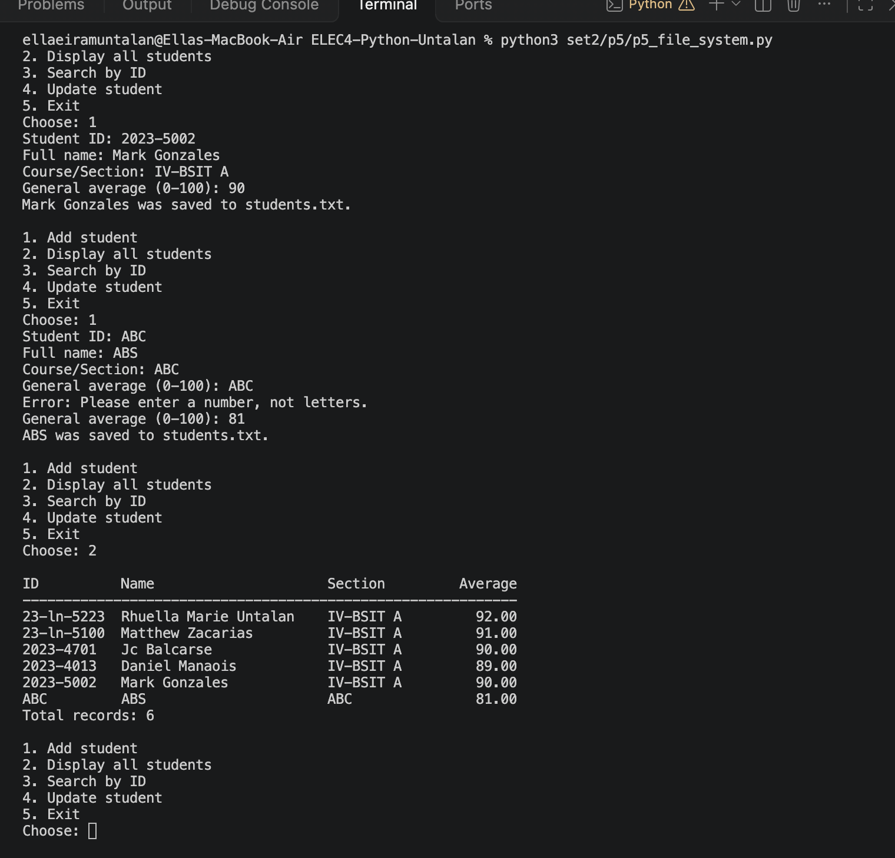
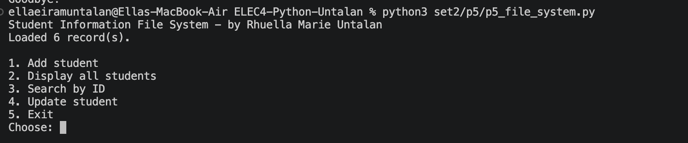
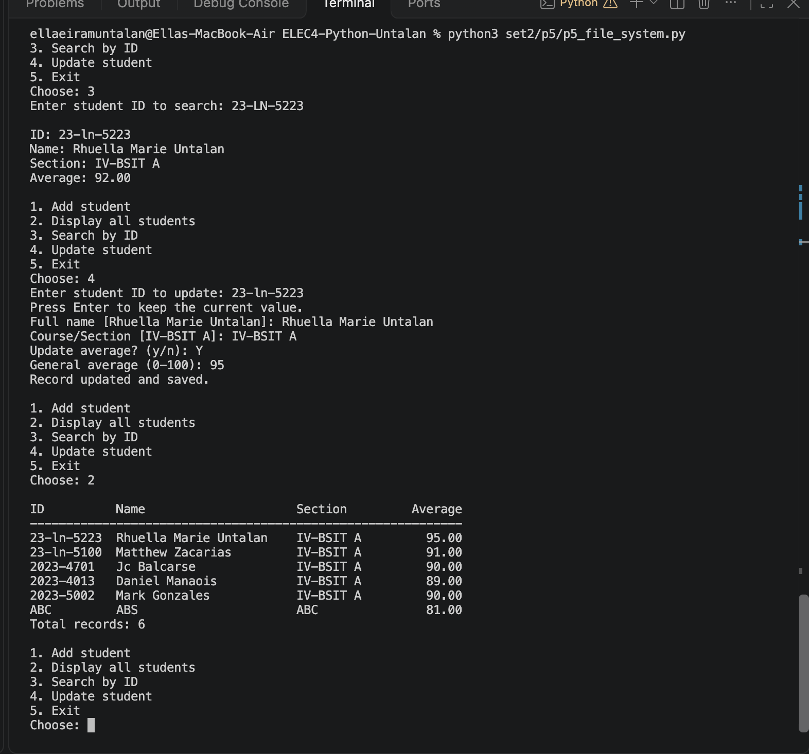
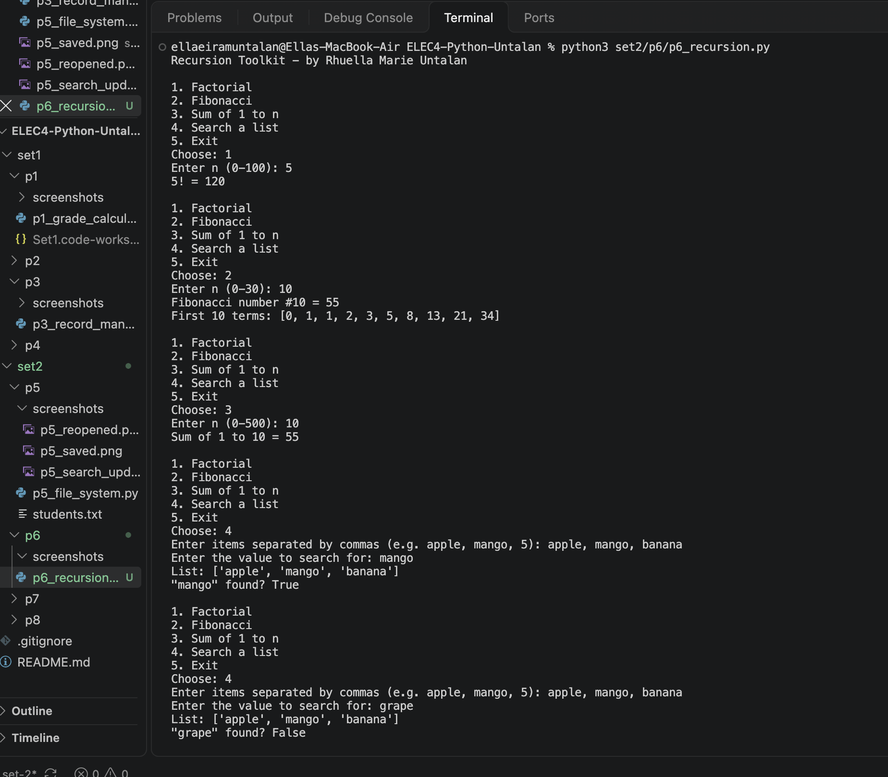
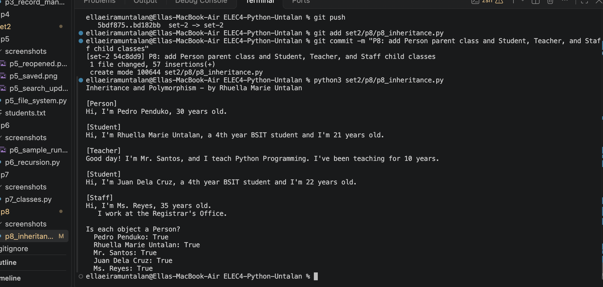

# ELEC 4 – Python Programming

**Name:** Rhuella Marie Untalan
**Section:** IV-BSIT A
**Course:** ELEC 4 – Python Programming
**Instructor:** Carl Gustaf Patrik B. Ferrer
**Reference:** [Python Full Course for free – Bro Code](https://www.youtube.com/watch?v=ix9cRaBkVe0)

This repository contains my outputs for the ELEC 4 Self-Paced Learning Assignment (lessons from November 9–20, 2026).

---

## Activities

### Set 1 (Nov 23–29, 2026)

| Code | Activity | Description | Folder |
|------|----------|-------------|--------|
| P1 | Student Grade Calculator | Menu-driven program that uses user-defined functions to compute the average, highest, lowest, and pass/fail status of grades. | [set1/p1](set1/p1/) |
| P2 | Custom Module: student_utils | A reusable `student_utils` module imported by a main program, plus a built-in module for the report date and time. | [set1/p2](set1/p2/) |
| P3 | Student Record Manager | Adds, removes, searches (partial match), and displays student names using lists and sets, with duplicate prevention. | [set1/p3](set1/p3/) |
| P4 | Safe Menu Program | Menu program that handles bad input with `try`, `except`, `else`, and `finally` so it never crashes. | [set1/p4](set1/p4/) |

### Set 2 (Nov 30–Dec 6, 2026)

| Code | Activity | Description | Folder |
|------|----------|-------------|--------|
| P5 | Student Information File System | Saves student records in `students.txt` and supports add, display, search by ID, and update, with records kept after the program closes. | [set2/p5](set2/p5/) |
| P6 | Recursion Toolkit | Recursive factorial, Fibonacci, sum of 1 to n, list search, and countdown, each with a clear base case. | [set2/p6](set2/p6/) |
| P7 | Student Management System with Classes | `Subject`, `Student`, and `Section` classes working together, with a private grade protected by getter and setter methods. | [set2/p7](set2/p7/) |
| P8 | Inheritance and Polymorphism | A `Person` parent class with `Student`, `Teacher`, and `Staff` child classes that override `introduce()`. | [set2/p8](set2/p8/) |

---

## Requirements

- Python 3.x
- No external packages needed (only built-in modules are used)

Clone the repository and go into it:

```bash
git clone https://github.com/Ella-Eiram/ELEC4-Python-Untalan.git
cd ELEC4-Python-Untalan
```

On Windows, use `python` instead of `python3` in the commands below.

---

## How to Run – Set 1

### P1 – Student Grade Calculator

```bash
python3 set1/p1/p1_grade_calculator.py
```

Choose **Enter grades**, type the grades (0–100), then choose **View results** to see the average, highest, lowest, and pass/fail status. A passing average is 75.



### P2 – Custom Module: student_utils

Run this from inside the `p2` folder so Python can find `student_utils.py`:

```bash
cd set1/p2
python3 p2_main.py
```


### P3 – Student Record Manager

```bash
python3 set1/p3/p3_record_manager.py
```

Menu options: add, remove, search, and display all students. Names are treated as case-insensitive (`Juan Cruz` and `juan cruz` count as the same name), and searching works on part of a name.




### P4 – Safe Menu Program

```bash
python3 set1/p4/p4_exceptions.py
```

Handled errors: non-numeric input (`ValueError`), division by zero (`ZeroDivisionError`), a missing file (`FileNotFoundError`), a folder name instead of a file (`IsADirectoryError`), and an invalid menu choice. Use `sample.txt` to test opening a file that exists.



---

## How to Run – Set 2

### P5 – Student Information File System

```bash
python3 set2/p5/p5_file_system.py
```

Records are saved in `set2/p5/students.txt`, one student per line in the format `ID|Full Name|Course/Section|Average`. If the file does not exist yet, the program starts with an empty list instead of crashing.





### P6 – Recursion Toolkit

```bash
python3 set2/p6/p6_recursion.py
```

Menu options: factorial, Fibonacci (with the first n terms), sum of 1 to n, search a list, and countdown. No loops are used inside the recursive functions.



### P7 – Student Management System with Classes

```bash
python3 set2/p7/p7_classes.py
```

Creates a section with three students, updates one of them (including a rejected invalid grade), and displays everyone before and after the update.


### P8 – Inheritance and Polymorphism

```bash
python3 set2/p8/p8_inheritance.py
```

Stores `Person`, `Student`, `Teacher`, and `Staff` objects in one list and calls `introduce()` on each, showing a different output for each class.



---

## Repository Structure

```
ELEC4-Python-Untalan/
├── README.md
├── .gitignore
├── set1/
│   ├── p1/
│   │   ├── p1_grade_calculator.py
│   │   └── screenshots/
│   ├── p2/
│   │   ├── student_utils.py
│   │   ├── p2_main.py
│   │   └── screenshots/
│   ├── p3/
│   │   ├── p3_record_manager.py
│   │   └── screenshots/
│   └── p4/
│       ├── p4_exceptions.py
│       ├── sample.txt
│       └── screenshots/
└── set2/
    ├── p5/
    │   ├── p5_file_system.py
    │   ├── students.txt
    │   └── screenshots/
    ├── p6/
    │   ├── p6_recursion.py
    │   └── screenshots/
    ├── p7/
    │   ├── p7_classes.py
    │   └── screenshots/
    └── p8/
        ├── p8_inheritance.py
        └── screenshots/
```
